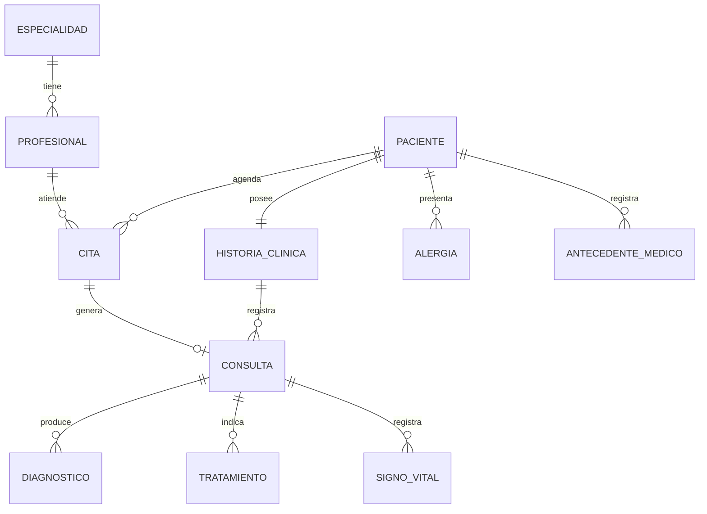

# Modelo de clases — Salud360

## Entidades
Paciente, Profesional, Especialidad, Cita, HistoriaClinica, Consulta, Diagnostico,
Tratamiento, Medicamento, SignoVital, Alergia y AntecedenteMedico.

## Relaciones
- Especialidad 1:N Profesional
- Paciente 1:N Cita
- Profesional 1:N Cita
- Paciente 1:1 HistoriaClinica
- HistoriaClinica 1:N Consulta
- Cita 1:0..1 Consulta
- Consulta 1:N Diagnostico
- Consulta 1:N Tratamiento
- Consulta 1:N SignoVital
- Paciente 1:N Alergia
- Paciente 1:N AntecedenteMedico

## Diagrama Mermaid

